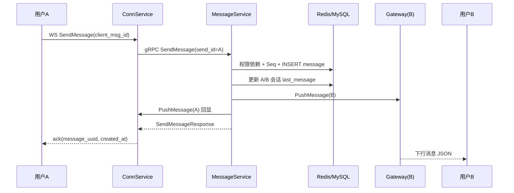

# Message 服务功能需求说明（由现有实现反推）

> 反推日期：2026-10-25  
> 反推范围：`api/proto/message.proto`、`internal/message/*`、`internal/gateway/*`、`internal/infra/grpc_client/client.go`、`configs/envoy.yaml`、`web/js/app.js`、相关 migration 与测试。  
> 说明：本文描述“当前代码实际承诺的行为”，即 As-Is 需求基线，不是重新设计后的 To-Be 方案。第 10 节单独列出代码与需求冲突、以及需要产品确认的缺口。

---

## 1. 结论先行

Message 服务在系统中的定位是：

1. **消息事实源**：负责单聊/群聊消息的落库、查询、撤回。
2. **会话读模型**：维护每个用户视角下的会话列表、最后一条消息、置顶状态。
3. **实时下行触发者**：消息落库后，按用户在线路由把消息推给 ConnService，由 ConnService 写回 WebSocket。
4. **跨服务事件投影器**：消费 `domain_events`，把群组、好友关系变化投影成本地会话变更。

由此可反推出六条核心不变量：

| 编号 | 不变量 |
|---|---|
| INV-1 | 消息必须先成功落库，才允许触发实时推送；推送失败不回滚消息。 |
| INV-2 | 单聊消息的 `session_id` 必须归一化为 `P_{min}_{max}`，群聊为 `groupId`；同一对用户双向读写必须命中同一个会话。 |
| INV-3 | 同一会话内消息具备单调递增的 `seq_id`，用于断线增量同步与乱序校验。 |
| INV-4 | 携带 `client_msg_id` 的发送必须幂等：重复请求返回首次结果，不重复落库、不重复推送。 |
| INV-5 | 只有文本、文件两类消息允许客户端发送；撤回只能由发送者在 2 分钟内发起。 |
| INV-6 | 会话是“每个用户一行”的读模型，只能由本人打开、置顶、删除；群/好友变化通过事件批量维护。 |

---

## 2. 服务边界

### 2.1 本服务负责

| 能力 | 说明 |
|---|---|
| 发送消息 | 文本、文件；单聊、群聊 |
| 消息持久化 | `message` 表 |
| 历史查询 | 单聊、群聊；游标分页；兼容分页接口 |
| 消息撤回 | 发送者 2 分钟内撤回，内容清空，类型改为 4 |
| 会话管理 | 打开/创建、列表、置顶、删除 |
| 会话读模型 | 最后一条消息、最后消息时间、最后消息类型、最后 Seq |
| 实时下行触发 | 查 Redis 在线路由，调用 ConnService 的 gRPC 推送接口 |
| 群聊扇出 | 群成员 ID 缓存、按网关实例聚合、批量推送 |
| 领域事件投影 | 群创建/加入/解散/踢人/退群；好友拉黑/删除 |

### 2.2 本服务不负责

| 能力 | 归属 |
|---|---|
| 登录、JWT 签发与校验 | user/auth 服务、边缘网关 |
| 好友关系、拉黑、备注 | friendship 服务 |
| 群资料、群成员、群权限 | group 服务 |
| 用户昵称、头像 | user 服务 |
| WebSocket 连接维护、心跳、连接注册 | ConnService |
| 文件上传、对象存储、CDN | 外部文件服务；Message 只保存 URL 与文件元数据 |
| 未读数、已读回执、消息搜索、消息编辑、@提醒、正在输入 | 当前实现未覆盖 |
| 离线消息堆积与离线推送 | 当前实现不保存离线推送任务，依赖历史查询补偿 |

### 2.3 外部依赖

| 依赖 | 用途 | 失败时当前行为 |
|---|---|---|
| MySQL `chat_message` | `message`、`session` 持久化 | 发送失败返回服务繁忙；查询失败返回服务繁忙 |
| Redis | 幂等、Seq 发号、会话缓存、消息 ZSET、群成员缓存、在线路由 | 部分能力降级到 DB；推送直接丢失 |
| user 服务 | 用户状态、公开资料 | 发送权限检查失败时放行；资料补全失败时昵称/头像为空 |
| friendship 服务 | 好友关系状态 | 发送权限检查失败时放行；历史查询失败时拒绝 |
| group 服务 | 群成员校验、群成员列表、群详情 | 发送权限检查失败时放行；群扇出失败时不下发 |
| Kafka `domain_events` | 接收群/好友领域事件 | 消费失败记录日志，位点不提交，重启后重放 |
| ConnService | 下行消息写入 WebSocket | 记录丢弃指标并清理失效路由，不回滚消息 |

---

## 3. 领域模型与数据规则

### 3.1 标识符规则

| 标识 | 格式 | 含义 |
|---|---|---|
| 用户 ID | `U...` | user 服务生成的用户 UUID |
| 群 ID | `G...` | group 服务生成的群 UUID |
| 消息 UUID | `M` + Snowflake | `message.uuid`，全局唯一 |
| 会话行 UUID | `S` + Snowflake | `session.uuid`，每个用户视角一行 |
| 单聊消息会话 ID | `P_{min}_{max}` | 双方用户 ID 按字典序排列，保证双向一致 |
| 群聊消息会话 ID | `G...` | 直接使用群 ID |
| 会话内序号 | 正整数 | `message.seq_id`，同一个 `session_id` 内递增 |

关键区别：

- `message.session_id` 是“聊天双方/群的逻辑会话标识”，单聊为 `P_...`，群聊为 `G...`。
- `session.uuid` 是“某个用户自己的会话列表行”的主键，形如 `S...`。
- 客户端传来的 `session_id` 只有在以 `P_` 或 `G` 开头时才会被直接采用；否则服务端根据 `send_id`、`receive_id` 重新计算。当前实现没有校验客户端传入的 `P_...` 是否确实属于这两个用户，这是一个安全缺口（见 10.1）。

### 3.2 Message 表

| 字段 | 类型/约束 | 说明 |
|---|---|---|
| `uuid` | `char(20)` PK | `M` + Snowflake |
| `client_msg_id` | `varchar(64)` UNIQUE NULL | 客户端幂等键；可为空 |
| `session_id` | `varchar(64)` NOT NULL | 单聊 `P_...`，群聊 `G...` |
| `seq_id` | `bigint` NOT NULL DEFAULT 0 | 会话内序号，非唯一索引 |
| `type` | `tinyint` | 0 文本、2 文件、4 撤回；1/3 为历史保留值 |
| `content` | `text` | 文本内容；文件消息为空；撤回后为空 |
| `url` | `char(255)` | 文件 URL |
| `send_id` | `char(20)` NOT NULL | 发送者 |
| `receive_id` | `char(20)` NOT NULL | 接收者：用户或群 |
| `file_type` | `char(50)` | 文件 MIME |
| `file_name` | `varchar(50)` | 文件名 |
| `file_size` | `char(20)` | 文件大小，字符串存储 |
| `created_at` | `datetime` NOT NULL | 创建时间 |

索引：

- `PRIMARY KEY (uuid)`
- `UNIQUE (client_msg_id)`
- `(session_id, uuid DESC)`：会话历史游标查询
- `(receive_id, uuid DESC)`：群历史游标查询
- `(session_id, seq_id)`：Seq 增量同步
- `send_id`、`receive_id` 单列索引

不存在 `deleted_at`：消息不做软删除；撤回是状态变更，不是删除。

### 3.3 Session 表

| 字段 | 类型/约束 | 说明 |
|---|---|---|
| `uuid` | `char(20)` PK | `S` + Snowflake |
| `send_id` | `char(20)` NOT NULL | 会话拥有者 |
| `receive_id` | `char(20)` NOT NULL | 对方用户或群 |
| `last_message` | `text` | 最后一条消息摘要 |
| `last_message_at` | `datetime` NULL | 最后消息时间 |
| `last_message_type` | `tinyint` | 最后消息类型 |
| `last_seq_id` | `bigint` DEFAULT 0 | 最后消息 Seq，用于防止旧消息覆盖新消息 |
| `is_pinned` | `boolean` DEFAULT false | 是否置顶 |
| `created_at` | `datetime` NOT NULL | 创建时间 |

约束与语义：

- `UNIQUE (send_id, receive_id)`：每个用户对每个对象只有一行会话。
- 会话是**每个用户一行**：A 对 B 的会话与 B 对 A 的会话是两行，各自维护置顶、最后消息。
- 不存在 `deleted_at`：删除会话是物理删除，删除后唯一键释放，可重新创建。
- 会话列表排序：游标模式为 `is_pinned DESC, last_message_at DESC, created_at DESC`；分页模式为 `is_pinned DESC, last_message_at DESC`。

### 3.4 消息类型

| 值 | 名称 | 客户端可发送 | 说明 |
|---|---|---|---|
| 0 | `Text` | 是 | 文本 |
| 1 | 历史语音 | 否 | 已移除，仅保留编号，服务端拒绝 |
| 2 | `File` | 是 | 文件/图片等统一按文件消息承载 |
| 3 | 历史音视频通话 | 否 | 已移除，仅保留编号，服务端拒绝 |
| 4 | `Recall` | 否 | 服务端撤回后写入 |
| 99 | `KickNotification` | 否 | 设备下线/互踢通知，不属于消息发送链路 |

类型数值会持久化到数据库并传给客户端，不能重新分配。

### 3.5 顺序与时间

- `message.created_at` 由数据库/应用写入；响应格式固定为 `2006-01-02 15:04:05`。
- `seq_id` 由 `session:seq:<session_id>` 的 Redis `INCR` 生成；首次分配时如果 DB 已有更大的 `seq_id`，用 Lua 校准到 `max+1`。
- Redis 不可用时，降级为 `SELECT MAX(seq_id)+1`，再写入。
- 历史列表按 `uuid DESC` / `created_at DESC` 倒序；新消息在前，客户端需要自行反转渲染。
- `seq_id` 的正常语义是“同一会话内单调递增”，但数据库只有普通索引、没有唯一约束；极端并发或 Redis 数据丢失时可能出现重复，需要服务端进一步保证或客户端容忍。

---

## 4. 功能需求

### 4.1 需求清单

| 编号 | 需求 | 优先级 |
|---|---|---|
| FR-MSG-01 | 发送文本/文件消息 | P0 |
| FR-MSG-02 | 消息发送幂等 | P0 |
| FR-MSG-03 | 会话内 Seq 分配 | P0 |
| FR-MSG-04 | 单聊历史查询 | P0 |
| FR-MSG-05 | 群聊历史查询 | P0 |
| FR-MSG-06 | 统一历史查询与游标分页 | P0 |
| FR-MSG-07 | 基于 Seq 的增量同步 | P1 |
| FR-MSG-08 | 消息撤回 | P0 |
| FR-SES-01 | 会话准入检查 | P0 |
| FR-SES-02 | 打开/创建会话 | P0 |
| FR-SES-03 | 会话列表 | P0 |
| FR-SES-04 | 会话置顶 | P1 |
| FR-SES-05 | 删除会话 | P1 |
| FR-SES-06 | 群相关事件投影 | P1 |
| FR-SES-07 | 好友关系事件投影 | P1 |
| FR-PUSH-01 | WebSocket 上行接入 | P0 |
| FR-PUSH-02 | 单聊/群聊实时下行 | P0 |
| FR-PUSH-03 | 在线路由与失败清理 | P0 |
| FR-SYNC-01 | 领域事件消费 | P1 |

---

### FR-MSG-01 发送文本/文件消息

**入口**

- WebSocket：客户端向 ConnService 的 `/ws` 发送 JSON，ConnService 调 gRPC `SendMessage`。
- gRPC：`MessageService.SendMessage`。
- 当前没有可用的 HTTP 发送入口（见 10.1）。

**请求字段**

| 字段 | 必填 | 说明 |
|---|---|---|
| `send_id` | 是（WS 由连接身份覆盖） | 发送者 |
| `receive_id` | 是 | `U...` 或 `G...` |
| `type` | 是 | 0 文本、2 文件 |
| `content` | 文本必填 | 文本内容 |
| `url` | 文件必填 | 文件地址 |
| `file_name` | 文件必填 | 文件名 |
| `file_type` | 否 | MIME |
| `file_size` | 否 | 文件大小字符串 |
| `session_id` | 否 | 客户端可带；服务端只接受 `P_` / `G` 前缀 |
| `client_msg_id` | 否 | 幂等键；为空时尝试取 `x-idempotency-key` 元数据 |
| `send_name` | 否 | 发送者昵称，用于实时下行展示 |
| `send_avatar` | 否 | 发送者头像，用于实时下行展示 |

**处理流程**

1. **校验接收者**：`receive_id` 不能为空。
2. **发送权限校验**：
   - 单聊 `U...`：
     - 发送者被禁用：拒绝，提示“您的账号已被禁用，无法发送消息”。
     - 好友状态 1（正常好友）、2（我拉黑了对方）：允许。
     - 好友状态 3（被对方拉黑）：拒绝，“消息已发出，但被对方拒收了”。
     - 好友状态 4（被对方单向删除）：拒绝，“开启了朋友验证，你还不是他（她）朋友”。
     - 好友状态 0（非好友）：拒绝，“你们不是好友，请先添加好友”。
   - 群聊 `G...`：调用 group 服务校验成员；非成员拒绝，“你不是该群成员，无法发送消息”。
   - 依赖调用异常时，当前实现会**放行**（fail-open），这是一个需要产品确认的安全策略（见 10.1）。
3. **计算会话 ID**：
   - 群聊：`session_id = receive_id`。
   - 单聊：若客户端 `session_id` 为空或不是 `P_`/`G` 前缀，则用 `P_{min(send,receive)}_{max(send,receive)}`。
4. **分配 `seq_id`**：见 FR-MSG-03。
5. **落库**：
   - 文本：清空 `url`、`file_type`、`file_name`，`file_size` 置为 `"0B"`。
   - 文件：清空 `content`，保留文件元数据。
   - 使用 `INSERT ... ON CONFLICT (client_msg_id) DO NOTHING` 作为数据库层幂等兜底。
6. **更新会话读模型**：
   - 单聊：更新发送者和接收者各自会话行的 `last_message`、`last_message_at`、`last_message_type`、`last_seq_id`。
   - 群聊：只更新发送者自己的群会话行；其他成员的会话行不会被逐条更新。
   - 文本摘要为原文；文件摘要为 `[文件] <file_name>`。
   - 更新失败只记录日志，不阻断发送。
7. **实时下行**：
   - 单聊：推给接收者，同时回推给发送者（多端/确认用途）。
   - 群聊：异步扇出给所有群成员。
8. **返回**：
   - `message_uuid`
   - `created_at`
   - 内部 DTO 还包含 `seq_id`，但 gRPC/HTTP 响应未暴露（见 10.1）。

**响应**

```json
{
  "message_uuid": "M...",
  "created_at": "2026-10-25 12:00:00"
}
```

**错误语义**

| 场景 | 业务码 |
|---|---|
| 参数错误、类型不支持 | 1001 |
| 未登录/身份缺失 | 1006 |
| 非好友、被拉黑、非群成员、发送者禁用 | 1007 |
| 资源不存在 | 1008 |
| 服务/数据库繁忙 | 1005 |
| 幂等请求处理中 | 1012 |

**验收要点**

- 文本消息落库后，`content` 保留，文件字段清空。
- 文件消息落库后，`content` 为空，文件字段保留，会话摘要为 `[文件] 文件名`。
- 非好友发送被拒绝，且不产生消息记录。
- 群非成员发送被拒绝，且不产生消息记录。
- 消息落库成功后，即使在线推送失败，发送仍返回成功。

---

### FR-MSG-02 消息发送幂等

**触发条件**：请求携带 `client_msg_id`（或 gRPC metadata `x-idempotency-key`）。

**规则**

1. 幂等键格式：`msg:dedup:<client_msg_id>`。
2. 处理中租约：5 秒；成功结果保留：24 小时。
3. 状态机：
   - 首次请求：获取锁，状态 `PROCESSING`，执行业务。
   - 并发重复请求：看到 `PROCESSING`，返回 1012“请求正在处理中，请勿重复提交”。
   - 已完成请求：看到 `SUCCESS`，直接回放首次的 `message_uuid`、`created_at`、`seq_id`，不重复落库、不重复推送。
   - 业务失败：删除幂等键，允许客户端用同一 `client_msg_id` 重试。
4. 数据库兜底：`client_msg_id` 唯一索引 + `ON CONFLICT DO NOTHING`。
5. 未携带 `client_msg_id` 的请求不具备幂等保证。

**验收要点**

- 同一 `client_msg_id` 连续发送两次，只产生一条消息，两次返回相同 `message_uuid`。
- 两个并发请求使用同一 `client_msg_id`，其中一个成功，另一个返回 1012。
- 首次落库失败后，同一 `client_msg_id` 重试可以成功。
- 幂等回放不会再次触发实时推送。

---

### FR-MSG-03 会话内 Seq 分配

**规则**

1. Redis key：`session:seq:<session_id>`。
2. 正常路径：`INCR` 返回的值即 `seq_id`。
3. 冷启动校准：当 `INCR` 返回 1 时，查询 DB `MAX(seq_id)`；若 DB 已有值，用 Lua 将 Redis 校准到 `max+1`，避免重启后从 1 重新计数。
4. Redis 故障：降级为 DB `MAX(seq_id)+1`。
5. `seq_id` 用于：
   - 会话列表的 `last_seq_id` 单调更新；
   - 消息增量同步 `after_seq`；
   - 客户端乱序检测（当前协议未暴露，见 10.1）。

**验收要点**

- 同一会话连续发送，`seq_id` 递增。
- Redis key 丢失后，下一条消息的 `seq_id` 大于 DB 中已有最大值。
- 旧消息的会话更新不能覆盖新消息的 `last_seq_id`。

---

### FR-MSG-04 单聊历史查询

**入口**：`GET /messages?target_id=<对方用户ID>&cursor=<消息UUID>&page_size=<n>`。

**规则**

1. 请求者身份优先取 `requester_id`；为空时取受信头 `X-User-Id`；仍为空返回 1006。
2. 必须与 `target_id` 是好友，且好友状态必须为 1；状态 0/2/3/4 均拒绝。
3. 计算出规范会话 ID：`P_{min}_{max}`。
4. 按 `session_id` 查询，不按 `(send_id, receive_id)` 组合查询。
5. 默认 `page_size=20`，允许 1–100；超出范围回退为 20。
6. 游标：
   - 空游标：从最新消息开始。
   - `M...`：按 `uuid < cursor` 继续向更旧消息翻页。
   - 数字：按 `created_at < 该时间戳` 翻页（兼容旧客户端）。
7. 每次多取 1 条判断 `has_more`；返回的 `next_cursor` 是本次最后一条消息的 UUID。
8. 结果按从新到旧返回；客户端渲染时需反转。
9. 返回前补全发送者昵称、头像；补全失败时字段为空，不阻断查询。
10. `file_size` 在 proto 中是 `int64`，服务端从字符串解析；`"0B"` 等非纯数字会变成 0。

**验收要点**

- 非好友查询返回 1007，不返回消息。
- A 查 B 与 B 查 A 得到同一批消息，顺序一致。
- 第一页返回 `page_size` 条，`has_more=true` 时可用 `next_cursor` 继续。
- 最后一页 `has_more=false`，`next_cursor` 为空。
- 撤回消息仍出现在历史中，`type=4`、`content` 为空。

---

### FR-MSG-05 群聊历史查询

**入口**：`GET /messages?target_id=<群ID>&cursor=...&page_size=...`，或 `GET /messages/group?group_id=...`。

**规则**

1. 请求者身份同上。
2. 当前实现不直接调用 group 服务校验成员，而是要求请求者在 `session` 表中存在 `(send_id=请求者, receive_id=群ID)` 的会话行；不存在则拒绝“您没有该群的会话记录”。
3. 查询 `message.session_id = groupId`。
4. 分页、游标、排序、资料补全规则与单聊一致。
5. 群成员被踢/退群后，事件会删除其群会话；此后历史查询会被拒绝，但消息数据仍保留。

**验收要点**

- 群成员且有会话行：可查询群历史。
- 非群成员或无会话行：返回 1007。
- 群历史中能看到所有成员发送的消息，并带发送者昵称/头像。
- 群会话被删除后，原成员无法再通过该接口读取群历史（当前行为）。

---

### FR-MSG-06 统一历史查询与游标分页

**入口**：`GET /messages`，`target_id` 以 `G` 开头走群聊，否则走单聊。

**规则**

1. `page_size` 默认 20，最大 100。
2. 返回 `list`、`next_cursor`、`has_more`。
3. 单条消息字段：

```json
{
  "send_id": "U...",
  "send_name": "昵称",
  "send_avatar": "头像URL",
  "receive_id": "U.../G...",
  "type": 0,
  "content": "文本",
  "url": "",
  "file_type": "",
  "file_name": "",
  "file_size": 0,
  "created_at": "2026-10-25 12:00:00"
}
```

4. 热点缓存：
   - key：`msg:zset:<session_id>`。
   - 成员：消息 JSON；score：优先 `seq_id`，其次 Snowflake 时间，再退化为 `created_at` 微秒。
   - 保留最近 200 条，TTL 7 天。
   - 首页未命中时从 DB 回填；撤回时同步修改缓存中的对应成员。
   - 缓存命中但没有明确“还有更多”（返回条数 ≤ 一页）且 ZSET 总数 ≥ 200 时，回源 DB 防止“只看到缓存头段”。
5. 兼容接口：
   - `GetMessageList` / `GetGroupMessageList`：传统 `page/page_size` + `total`，仅内部 gRPC 使用，无 HTTP 注解。
6. `seq_id`、`client_msg_id` 在当前 proto 的 `GetMessageListRespond` 中不存在；实时下行 JSON 中存在 `seq_id`，但历史响应没有（见 10.1）。

**验收要点**

- `target_id` 为群 ID 时自动走群聊历史。
- 游标为空返回最新一页；游标为最后一条 UUID 时返回更旧一页。
- `has_more` 与 `next_cursor` 配套正确。
- 缓存能完整判定结果时不查 DB；命中但无法确定是否还有更旧数据时回源 DB 并回填。
- 撤回后再次查询，缓存与 DB 都返回 `type=4`、空内容。

---

### FR-MSG-07 基于 Seq 的增量同步

**现状**：服务层已实现 `SyncMessages(requesterId, sessionId, afterSeq, limit)`，但 proto 没有对应 RPC，HTTP 也没有暴露，属于“有实现、无入口”的能力。

**规则**

1. 参数：
   - `sessionId`：`G...` 或 `P_...`。
   - `afterSeq`：客户端已收到的最大 Seq。
   - `limit`：默认 50，允许 1–100。
2. 权限：
   - 群聊：必须存在该用户的群会话行。
   - 单聊：`sessionId` 必须能被解析为 `P_用户A_用户B`，且请求者是其中一方。
3. 查询 `session_id = ? AND seq_id > ? ORDER BY seq_id ASC LIMIT ?`。
4. 返回补全资料后的消息列表，不返回 `next_cursor`；客户端用最后一条的 `seq_id` 作为下次 `afterSeq`。

**验收要点**

- 非会话参与者返回 1007。
- `afterSeq=0` 返回该会话最早的至多 `limit` 条。
- `afterSeq` 为已收到最大 Seq 时，只返回更新的消息。
- 返回结果按 `seq_id` 升序。

---

### FR-MSG-08 消息撤回

**入口**：`POST /messages/recall`，body `{ "message_uuid": "M..." }`。

**规则**

1. 请求者身份优先取 `user_id`，为空取 `X-User-Id`；为空返回 1006。
2. 消息必须存在；不存在返回 1001“消息不存在”。
3. 只有发送者本人可以撤回；否则 1007“只能撤回自己发送的消息”。
4. 已撤回的消息再次撤回：直接返回成功（幂等），不再推送。
5. 超过 2 分钟：拒绝 1007“消息发送超过2分钟，无法撤回”。
6. 更新方式：
   - `UPDATE message SET content='', type=4 WHERE uuid=? AND type!=4`。
   - 影响行数为 0 时重新查询并做二次判定，处理并发重复撤回。
7. 成功后：
   - 推送撤回通知给接收者；单聊额外推送给发送者本人。
   - 群聊推送给所有群成员（逐个推送，未批量）。
   - 更新会话最后消息为 `[一条消息已被撤回]`；由于会话更新带 `last_seq_id` 条件，只有被撤回消息仍是最后一条时才会真正覆盖。
   - 同步修正消息 ZSET 缓存中的对应消息。
8. 撤回通知格式：

```json
{
  "type": 4,
  "message_uuid": "M..."
}
```

**验收要点**

- 发送者 2 分钟内撤回成功，历史中该消息变为 `type=4`、空内容。
- 非发送者撤回返回 1007。
- 超过 2 分钟返回 1007。
- 重复撤回返回成功，且不重复推送。
- 单聊双方都收到撤回通知；群聊所有成员都收到。
- 撤回不会物理删除消息。

---

### FR-SES-01 会话准入检查

**入口**：`GET /sessions/check?target_id=<用户或群ID>`，对应 gRPC `CheckOpenSessionAllowed`。

**规则**

1. `send_id` 优先取请求体；为空取 `X-User-Id`；仍为空返回 1006。
2. `receive_id` 优先取 `receive_id`，为空取 `target_id`；仍为空返回 1001。
3. 单聊 `U...`：
   - 好友状态 0：拒绝“你们还不是好友，无法发起会话”。
   - 状态 3：拒绝“已被对方拉黑，无法发起会话”。
   - 状态 2：拒绝“已拉黑对方，先解除拉黑状态才能发起会话”。
   - 状态 1：继续检查目标用户状态。
   - 状态 4：当前实现未显式拒绝，会继续放行（见 10.1）。
4. 群聊 `G...`：调用 group 服务校验成员；非成员拒绝“你不是该群成员，无法发起会话”。
5. 其他前缀：返回 1001“无效的接收方ID格式”。
6. 目标状态检查（带缓存）：
   - 用户：`user:info:<id>`，正常 TTL 30 分钟 ±10%，空值缓存 5 分钟；被禁用则拒绝“对方已被禁用，无法发起会话”。
   - 群：`group:info:<id>`，通过 `GetGroupDetail` 校验；群不存在/无权限/已解散则拒绝。
7. 返回 `{ "allowed": true }` 或错误；`allowed=false` 只在内部未抛错时出现，当前业务拒绝主要通过错误码表达。

**验收要点**

- 正常好友返回 allowed=true。
- 非好友、被拉黑、拉黑对方均返回 1007 或 1001，且不允许打开会话。
- 非群成员返回 1007。
- 被禁用用户返回 1001。
- 目标不存在返回 1003/1008（取决于依赖返回）。

---

### FR-SES-02 打开/创建会话

**入口**：`POST /sessions`，body `{ "receive_id": "U.../G..." }`。

**规则**

1. 先执行 FR-SES-01 的准入检查；不允许则直接拒绝。
2. 幂等：
   - 客户端可传 `client_token`，幂等键为 `session:open:<client_token>`。
   - 未传时幂等键为 `session:open:<sendId>:<receiveId>`。
   - 租约 5 秒，成功结果保留 24 小时。
3. 先查缓存 `session:open:<sendId>_<receiveId>`（TTL 1 分钟）；命中直接返回 `session.uuid`。
4. 缓存未命中查 `session` 表 `(send_id=sendId, receive_id=receiveId)`。
5. 已存在：返回已有 `session.uuid`，并异步回填缓存。
6. 不存在：调用 `CreateSession`：
   - 校验发送者存在且未禁用。
   - 单聊：校验接收者存在且未禁用；好友状态必须为 1（注意：这里不允状态 2，与发送消息允许状态 2 不一致）。
   - 群聊：调用 `GetGroupDetail(sendId, groupId)` 校验成员/群状态。
   - 生成 `S` + Snowflake 作为 `session.uuid`。
   - 插入 `session` 表；唯一键冲突时回查并返回已存在行。
7. 返回 `{ "session_id": "S..." }`。
8. 单聊只创建“发起者视角”的一行；被叫方不会自动获得会话行（见 10.1）。

**内部接口**

- `CreateSession(send_id, receive_id)`：供服务间调用，逻辑同上，但不做受信身份回填。
- `CreateGroupSession(group_id, user_id, group_name, group_avatar)`：幂等创建用户对群的会话；`group_name`、`group_avatar` 当前未使用。
- `DeleteGroupMemberSessions(group_id, user_ids)`：批量删除群成员会话。
- `DeleteFriendSessions(user_one_id, user_two_id)`：删除双方私聊会话。

**验收要点**

- 同一用户对同一目标重复打开，返回同一 `session.uuid`。
- 同一 `client_token` 重复打开，返回同一 `session.uuid`，不重复创建。
- 非好友/非群成员/被禁用目标无法创建。
- 群会话创建后，用户能在群会话列表中看到该群。
- 删除会话后再次打开，生成新的 `S...`（物理删除释放唯一键）。

---

### FR-SES-03 会话列表

**入口**

- 单聊：`GET /sessions/direct?cursor=...&page_size=...`
- 群聊：`GET /sessions/group?cursor=...&page_size=...`
- 兼容分页：`GetUserSessionList` / `GetGroupSessionList`（内部 gRPC，无 HTTP 注解）。

**规则**

1. 请求者身份优先取 `owner_id`，为空取 `X-User-Id`；为空返回 1006。
2. 过滤条件：`send_id = ownerId AND receive_id LIKE 'U%'` 或 `'G%'`。
3. 游标排序：`is_pinned DESC, last_message_at DESC, created_at DESC`；分页排序：`is_pinned DESC, last_message_at DESC`。
4. 游标模式：
   - `page_size` 默认 20，最大 100。
   - 游标格式 `pin_ts`：`pin` 为 0/1，`ts` 为 `last_message_at` 的 Unix 秒；无最后消息时用 `created_at`。
   - 置顶游标之后先返回剩余置顶会话，再返回非置顶会话。
   - 多取 1 条判断 `has_more`；`next_cursor` 为最后一条的 `pin_ts`。
5. 分页模式：返回 `total`，按 `is_pinned DESC, last_message_at DESC` 分页。
6. 资料补全：
   - 单聊：批量调用 user 服务获取昵称、头像。
   - 群聊：对每个群调用 group 服务获取群名、群头像；当前是逐会话调用，存在 N+1 开销。
7. 单聊返回字段：`session_id`、`avatar`、`user_id`、`username`、`last_message`、`last_message_time`、`last_message_type`、`is_pinned`。
8. 群聊返回字段：`session_id`、`avatar`、`group_id`、`group_name`、`last_message`、`last_message_time`、`last_message_type`、`is_pinned`。
9. 内部 DTO 有 `last_seq_id`，但 proto 未返回。

**验收要点**

- 置顶会话始终排在非置顶之前。
- 同一分组内按最后消息时间倒序；游标模式下没有最后消息的会话以 `created_at` 作为游标时间。
- 游标翻页不重复、不遗漏（秒级时间相同的会话可能边界不稳定，见 10.1）。
- 单聊昵称/头像、群名/群头像正确补全。
- 没有会话行时返回空列表，不自动创建。

---

### FR-SES-04 会话置顶

**入口**：`PUT /sessions/pin`，body `{ "session_id": "S...", "is_pinned": true }`。

**规则**

1. 请求者身份优先取 `user_id`，为空取 `X-User-Id`；为空返回 1006。
2. 会话必须存在；不存在返回 1008。
3. 只有 `session.send_id == userId` 才能操作；否则 1007“无权操作该会话”。
4. 更新 `is_pinned`；相同值不产生额外影响。
5. 置顶状态只影响当前用户自己的会话行。

**验收要点**

- 置顶后会话列表排到最前。
- 取消置顶后回到时间排序。
- 操作他人会话返回 1007。
- 重复置顶/取消置顶幂等。

---

### FR-SES-05 删除会话

**入口**

- `DELETE /sessions/{session_id}`
- `DELETE /sessions`，body `{ "session_id": "S..." }`

**规则**

1. 请求者身份优先取 `owner_id`，为空取 `X-User-Id`；为空返回 1006。
2. 会话不存在：返回成功（幂等）。
3. 只有 `session.send_id == ownerId` 才能删除；否则 1007“无权删除该会话”。
4. 物理删除 `session` 行，不删除消息，不删除对方会话。
5. 删除后异步清理 `session:open:<ownerId>_<receiveId>` 缓存。
6. 删除后再次打开会创建新的 `S...`，历史消息仍可查询。

**验收要点**

- 删除自己的会话成功，列表不再出现。
- 删除他人会话返回 1007。
- 重复删除返回成功。
- 删除后消息历史仍存在，重新打开会话可继续查看。
- 对方会话不受影响。

---

### FR-SES-06 群相关事件投影

**消费来源**：Kafka topic `domain_events`，消费组 `message_domain_events`，事件类型从消息头 `event_type` 读取。

| 事件 | 投影动作 | 终端通知 |
|---|---|---|
| `group_created` | 为群主创建群会话（幂等） | 给群主推 `system/group_created` |
| `group_joined` | 为新成员创建群会话（幂等） | 给新成员推 `system/group_joined` |
| `group_dismissed` | 删除 `receive_id = groupId` 的所有会话 | 无 |
| `group_member_removed` | 删除被移除成员的群会话 | 给每个被移除成员推 `system/kicked_from_group` |
| `group_member_left` | 删除退群成员的群会话 | 给退群者推 `system/left_group` |

**规则**

1. 创建群会话：若已存在则跳过；群 ID 必须以 `G` 开头，否则忽略。
2. 删除会话：查不到视为成功，保证事件重复消费幂等。
3. 通知 payload 形如：

```json
{
  "type": "system",
  "event": "group_joined",
  "group_id": "G...",
  "group_name": "群名"
}
```

4. 事件消费失败：记录日志与指标，**不提交位点**，但循环继续处理后续消息；重启后会从上次提交位点重放，属于至少一次语义，没有立即重试队列。
5. `group_updated`、`user_updated` 已不再消费：会话表不再冗余群名/头像/昵称，资料在查询时实时补全。

**验收要点**

- 建群后群主会话列表出现该群。
- 入群后新成员会话列表出现该群。
- 解散群后所有成员会话消失。
- 踢人/退群后对应成员会话消失，并收到系统通知。
- 同一事件重复消费不会重复创建或报错。

---

### FR-SES-07 好友关系事件投影

| 事件 | 投影动作 | 终端通知 |
|---|---|---|
| `friend_blacked` | 删除双方私聊会话 | 给被拉黑方推 `system/friend_blacked` |
| `friend_deleted` | 只删除操作人这一侧的私聊会话 | 无 |

**规则**

1. 拉黑：双方 `(A,B)`、`(B,A)` 两会话都删除。
2. 删除好友：只删除操作人 `(A,B)`，对方 `(B,A)` 保留（微信式单向删除）。
3. 删除不存在的会话视为成功。
4. 删除后消息历史仍保留；是否能再查询取决于好友状态（当前单聊历史要求状态 1，见 10.1）。

**验收要点**

- 拉黑后双方会话列表都不再出现对方。
- 删除好友后只有操作人会话消失。
- 重复事件幂等。
- 历史消息不被物理删除。

---

### FR-PUSH-01 WebSocket 上行接入

**入口**：ConnService `GET /ws`。

**认证**

1. 优先取 `X-User-Id` 请求头（边缘网关注入）。
2. 其次取 URL query `?token=<JWT>`。
3. 其次取 `Authorization: Bearer <JWT>`。
4. 均失败：HTTP 200 + JSON `{ "code": 1006, "msg": "请先登录" }`，不升级连接。

**连接建立**

1. 升级为 WebSocket。
2. 在本地 Hub 注册连接，同时同步写 Redis `user:gateway:<userId> = <gateway gRPC 地址>`，TTL 120 秒。
3. 向客户端发送欢迎系统消息：

```json
{ "type": "system", "content": "欢迎来到kama聊天服务器" }
```

**上行协议**

1. 客户端只能发送 `SendMessageRequest` 的 JSON。
2. ConnService 强制把 `send_id` 覆盖为连接身份，防止客户端伪造发送者。
3. 调用 Message 服务 `SendMessage`，超时 5 秒。
4. 成功回 ack：

```json
{
  "type": "ack",
  "message_uuid": "M...",
  "created_at": "2026-10-25 12:00:00",
  "client_msg_id": "..."
}
```

5. 失败回 error：

```json
{ "type": "error", "message": "错误信息" }
```

**心跳**

- 服务端每 54 秒发 Ping；60 秒内无 Pong 则断开。
- 收到 Pong、收到任意上行消息、发送 Ping 时都会续期 Redis 路由到 120 秒。
- 写超时 10 秒；下行队列长度 100。

**登出**

- `POST /ws/logout`，按认证身份找到连接并关闭；同时删除本地连接与 Redis 路由。

**验收要点**

- 未认证连接无法升级。
- 连接建立后能收到欢迎消息，Redis 路由可查。
- 上行消息的 `send_id` 被强制覆盖为连接用户。
- 成功收到 ack，失败收到 error。
- 60 秒无心跳断开；正常心跳保持在线。
- 登出后连接关闭，路由删除。

---

### FR-PUSH-02 单聊/群聊实时下行

**单聊**

1. 消息落库成功后，查接收者与发送者各自的网关路由。
2. 分别调用对应 ConnService 的 `PushMessage`。
3. 下行 payload 为消息 DTO JSON，包含 `seq_id` 与 `created_at`。
4. 发送者也会收到回显；客户端需按 `message_uuid` / `client_msg_id` 去重，避免与乐观 UI 重影。
5. 任一方不在线/路由缺失：该用户推送丢弃，记录 `MessagesDropped`，消息仍可通过历史查询获取。

**群聊**

1. 从 `group:member_ids:<groupId>` 读取群成员 ID；未命中回源 group 服务；TTL 5 分钟。
2. 并发查询每个成员的网关路由（并发上限 10，超时 3 秒）。
3. 按网关实例聚合用户列表。
4. 对每个网关调用 `BatchPushMessage`，批量写入该网关上的在线用户。
5. 网关返回 `failed_user_ids` 的，删除这些用户的 Redis 路由并计入丢弃。
6. 整个扇出在后台 goroutine 执行；进程内同时进行的群扇出上限 200，超过直接拒绝本次实时扇出，记录 `GroupFanoutRejected`。
7. 实时扇出失败不回滚消息；设计意图是由 Seq 增量同步补偿，但该接口当前未暴露。

**撤回通知**

- 单聊：接收者 + 发送者。
- 群聊：遍历所有群成员逐个 `PushMessage`，未按网关批量。
- 通知只含 `type=4`、`message_uuid`，不含原消息内容/发送者。

**失败处理**

- 用户不在线 / 路由过期 / 网关不认领：丢弃并清理路由。
- 网关 gRPC 调用失败：整批计为丢弃并清理这些用户的路由。
- 没有重试队列、没有离线消息表、没有客户端 ACK 确认。

**验收要点**

- 在线单聊双方都收到实时消息。
- 在线群成员都收到群消息；离线成员不受影响。
- 群成员多时按网关批量推送，而不是逐用户单推。
- 路由过期用户被丢弃并清理。
- 消息落库成功但推送失败时，发送接口仍成功。
- 群扇出达到并发上限时快速拒绝，不阻塞发送主流程。

---

### FR-PUSH-03 在线路由与失败清理

**Redis 路由**

- key：`user:gateway:<userId>`
- value：ConnService 的 gRPC 地址
- TTL：120 秒
- 写入：连接注册时同步写入（保证连接建立后立即可推送）
- 续期：Pong、上行消息、Ping
- 删除：连接关闭、登出、推送失败、网关返回失败用户

**ConnService 内部接口**

| 方法 | 行为 |
|---|---|
| `PushMessage(target_user_id, message_uuid, payload)` | 用户不在本网关返回 `success=false` 与原因 |
| `BatchPushMessage(target_user_ids, message_uuid, payload)` | 返回 `failed_user_ids`，其余用户写入各自下行队列 |

**验收要点**

- 连接建立后路由立即可见。
- 心跳期间路由不过期。
- 断连后路由被清理。
- 推送到错误网关时返回失败，Message 服务清理路由。
- 同一用户重复连接时，Hub 以最后一次注册为准（当前存在旧连接清理误删新路由的竞态，见 10.1）。

---

### FR-SYNC-01 领域事件消费

1. 订阅 Kafka `domain_events`。
2. 消费组：`message_domain_events`。
3. 事件类型从 header `event_type` 读取。
4. 使用事件 header 中的 trace context 建立消费 span，接入全链路追踪。
5. 成功处理才提交位点；失败记录 `kafka_consume_errors_total`，不提交位点。
6. 处理器按事件类型分发，未识别事件直接忽略并提交。
7. 所有投影动作必须幂等：已存在则跳过、删除不存在则成功。

**验收要点**

- 事件重复投递不产生重复会话。
- 未识别事件不阻塞消费。
- 处理失败后重启可重放。
- 事件链路 trace 能串联到生产端。

---

## 5. 接口清单

Message 服务自身是纯 gRPC，监听 `50056`；外部 HTTP/JSON 由 Envoy `grpc_json_transcoder` 按 proto 注解转码。只有带 `google.api.http` 注解的方法才有 HTTP 入口。

| RPC | HTTP 入口 | 主要调用方 | 用途 |
|---|---|---|---|
| `SendMessage` | 无（当前仅 WS/gRPC） | ConnService | 发送消息 |
| `GetMessageList` | 无 | 内部 | 单聊历史（page/total） |
| `GetGroupMessageList` | 无 | 内部 | 群聊历史（page/total） |
| `GetMessageListCursor` | `GET /messages/direct` | 客户端 | 单聊历史（游标） |
| `GetGroupMessageListCursor` | `GET /messages/group` | 客户端 | 群聊历史（游标） |
| `GetMessages` | `GET /messages` | 客户端 | 统一历史入口 |
| `RecallMessage` | `POST /messages/recall` | 客户端 | 撤回 |
| `CreateSession` | 无 | 内部 | 创建会话 |
| `CheckOpenSessionAllowed` | `GET /sessions/check` | 客户端 | 准入检查 |
| `OpenSession` | `POST /sessions` | 客户端 | 打开/创建会话 |
| `GetUserSessionList` | 无 | 内部 | 单聊会话分页 |
| `GetGroupSessionList` | 无 | 内部 | 群聊会话分页 |
| `GetUserSessionListCursor` | `GET /sessions/direct` | 客户端 | 单聊会话游标 |
| `GetGroupSessionListCursor` | `GET /sessions/group` | 客户端 | 群聊会话游标 |
| `DeleteSession` | `DELETE /sessions/{session_id}`、`DELETE /sessions` | 客户端 | 删除会话 |
| `PinSession` | `PUT /sessions/pin` | 客户端 | 置顶 |
| `DeleteGroupMemberSessions` | 无 | 内部 | 批量删除群成员会话 |
| `CreateGroupSession` | 无 | 内部 | 创建群会话 |
| `DeleteFriendSessions` | 无 | 内部 | 删除好友双方会话 |

补充：

- 受信身份头为 `X-User-Id`；多数查询/写接口在请求字段为空时会回填该头。
- `SendMessage` 是例外：当前没有从 `X-User-Id` 回填，完全依赖调用方传 `send_id`（WS 会覆盖，见 10.1）。
- proto 中 `SendMessageRequest` 的字段 12 已 `reserved`，音视频通话能力已移除。

---

## 6. 状态与关键时序

### 6.1 消息生命周期

```text
[创建] type=0/2
   │
   ├── 超过 2 分钟 ──> 不可撤回
   │
   └── 发送者 2 分钟内撤回
           │
           ▼
      [已撤回] type=4, content=""
           │
           └── 不可恢复；重复撤回幂等成功
```

### 6.2 会话生命周期

```text
[不存在]
   │ 打开会话 / 建群 / 入群
   ▼
[活跃] ── 新消息 ──> 更新 last_message / last_seq_id
   │
   ├── 置顶/取消置顶 ──> is_pinned
   │
   └── 用户删除 / 退群 / 被踢 / 拉黑 / 删好友
           │
           ▼
      [物理删除]（消息保留）
           │
           └── 再次打开 ──> 新 S... 会话行
```

### 6.3 单聊发送时序



注意：回显与 ack 可能以任意顺序到达；客户端应以 `message_uuid` / `client_msg_id` 去重。

### 6.4 群聊扇出时序

```text
SendMessage
  -> 落库
  -> 更新发送者群会话
  -> 异步 fanout
       -> 读群成员缓存（未命中回源 group）
       -> 并发查每个成员的 Redis 网关路由（上限 10）
       -> 按网关聚合
       -> 每个网关 BatchPushMessage
       -> 失败用户清理路由并计丢弃
```

### 6.5 事件投影时序

```text
group/friendship 服务
  -> outbox -> CDC -> Kafka domain_events
  -> message 消费组 message_domain_events
  -> SessionEventHandler
       -> create/delete session
       -> push system notice（用户在线时）
```

---

## 7. 非功能需求

### 7.1 一致性

| 编号 | 要求 | 现状 |
|---|---|---|
| NFR-C-01 | 同一会话内 `seq_id` 单调递增 | Redis INCR + DB 校准；无唯一约束，极端情况下可能重复 |
| NFR-C-02 | 会话最后消息不能被旧消息覆盖 | `UPDATE ... WHERE last_seq_id <= newSeq`，满足 |
| NFR-C-03 | 消息先落库后推送 | 满足 |
| NFR-C-04 | 推送失败不回滚消息 | 满足 |
| NFR-C-05 | 会话读模型最终一致 | 同步更新发送者/单聊接收者；群成员会话不逐条更新；事件投影异步 |
| NFR-C-06 | 历史缓存最终一致 | ZSET 异步写入/撤回修正；7 天过期；允许短时不一致 |

### 7.2 幂等性

| 场景 | 幂等键 | 结果保留 |
|---|---|---|
| 发送消息 | `msg:dedup:<client_msg_id>` | 24 小时 |
| 打开会话 | `session:open:<client_token>` 或 `session:open:<send>_<receive>` | 24 小时 |
| 撤回 | 消息 `type=4` 状态本身 | 永久 |
| 创建群会话 | `(send_id, receive_id)` 唯一键 | 永久 |
| 删除会话/群会话 | 删除不存在视为成功 | 永久 |
| 事件投影 | 存在则跳过、删除不存在则成功 | 永久 |

### 7.3 可用性与降级

| 故障 | 行为 |
|---|---|
| Redis 不可用 | Seq 降级 DB；历史缓存绕过；幂等能力可能失效；实时路由不可用 |
| MySQL 不可用 | 发送/查询失败，返回 1005 |
| friendship/group 依赖超时 | 发送权限检查 fail-open（放行）；历史/会话准入 fail-closed（拒绝） |
| 网关不可用 | 消息已落库，实时推送丢弃，记录指标 |
| Kafka 不可用 | 会话投影延迟；不影响消息发送 |
| 群成员缓存失效 | 回源 group 服务；失败则本次扇出不执行 |

### 7.4 性能与容量参数

| 参数 | 值 |
|---|---|
| 默认分页大小 | 20 |
| 最大分页大小 | 100 |
| 消息 ZSET 保留条数 | 200 |
| 消息 ZSET TTL | 7 天 |
| 群成员 ID 缓存 TTL | 5 分钟 |
| 群扇出并发上限 | 200 |
| 群成员路由查询并发 | 10 |
| 网关路由 TTL | 120 秒 |
| 会话打开缓存 TTL | 1 分钟 |
| 发送幂等租约 | 5 秒 |
| 发送幂等结果 TTL | 24 小时 |
| 撤回时间窗 | 2 分钟 |
| WS Pong 超时 | 60 秒 |
| WS Ping 周期 | 54 秒 |
| WS 写超时 | 10 秒 |
| WS 下行队列 | 100 |
| Message 服务 gRPC 超时 | 2 秒（Kratos） |
| Envoy 上游超时 | 15 秒 |
| 增量同步默认/最大条数 | 50 / 100 |
| 权限目标缓存 | 30 分钟 ±10%，空值 5 分钟 |

### 7.5 安全

| 编号 | 要求 | 现状 |
|---|---|---|
| NFR-S-01 | 所有用户操作必须绑定已认证身份 | 查询/会话接口支持 `X-User-Id`；`SendMessage` 未强制 |
| NFR-S-02 | 客户端不能伪造发送者 | WS 覆盖 `send_id`；直接 gRPC/HTTP 未覆盖 |
| NFR-S-03 | 单聊历史仅好友可读 | 要求好友状态 1 |
| NFR-S-04 | 群历史仅群成员可读 | 通过“存在群会话行”间接校验 |
| NFR-S-05 | 只能撤回自己发送的消息 | 满足 |
| NFR-S-06 | 只能操作自己的会话 | 满足 |
| NFR-S-07 | 客户端不能把消息写入他人会话 | 未校验客户端传入的 `P_...` 是否属于双方（缺口） |
| NFR-S-08 | 依赖故障时权限检查应 fail-closed | 发送路径当前 fail-open（缺口） |

### 7.6 可观测性

| 指标/日志 | 用途 |
|---|---|
| `MessagesConsumed{type}` | 按文本/文件统计发送量 |
| `MessagesDuplicated` | 幂等回放次数 |
| `MessagesDispatched` | 成功下行条数 |
| `MessagesDropped` | 路由缺失/推送失败/队列满导致丢弃 |
| `GroupFanoutRejected` | 群扇出并发限流拒绝次数 |
| `OnlineConnections` / `TotalConnections` / `TotalDisconnections` | 长连接水位 |
| `kafka_consume_errors_total` | 领域事件消费失败 |
| gRPC/HTTP trace | 跨服务调用链路 |
| Kafka trace header | 事件生产到消费的链路串联 |

### 7.7 兼容性与数据演进

- 消息类型数值冻结：0/2/4 已持久化；1/3 不可复用；99 为系统通知。
- `SendMessageRequest` 字段 12 已保留，禁止旧客户端把音视频字段重新解释为其他含义。
- `message` 表已删除 `status`、`send_at`、`av_data` 等未使用字段；新实现不得依赖。
- 会话表不再冗余群名/头像/昵称，资料查询时实时补全。
- 会话和消息均无软删除；删除会话是物理删除。
- migration 包括：`client_msg_id` 唯一索引、`(session_id, uuid)` / `(receive_id, uuid)` 复合索引、`session_id` 扩展到 64、删除无用字段。

---

## 8. 验收用例（现状基线）

| ID | Given | When | Then |
|---|---|---|---|
| AC-01 | A、B 是好友 | A 发文本给 B | 落库 1 条；A 收到 ack；A/B 在线均收到下行；B 会话最后消息更新 |
| AC-02 | A、B 是好友 | A 发文件给 B | `content` 为空，文件字段保留；会话摘要 `[文件] name` |
| AC-03 | A、B 非好友 | A 发消息给 B | 返回 1007；不落库；不推送 |
| AC-04 | B 拉黑 A | A 发消息给 B | 返回 1007“被对方拒收”；不落库 |
| AC-05 | A 拉黑 B | A 发消息给 B | 允许发送（微信式单向特权） |
| AC-06 | A 不是群成员 | A 发群消息 | 返回 1007；不落库 |
| AC-07 | 任意 | 发送 type=1/3/5 | 返回 1001“不支持的消息类型”；不落库 |
| AC-08 | 同一 `client_msg_id` | 连续发送两次 | 只落库 1 条；两次返回同一 `message_uuid`；只推送一次 |
| AC-09 | 同一 `client_msg_id` | 两个并发请求 | 一个成功；另一个返回 1012 |
| AC-10 | A、B 是好友，有多页消息 | A 查单聊历史 | 新到旧返回；`has_more`/`next_cursor` 正确；第二页继续更旧 |
| AC-11 | 群成员且有群会话 | 查群历史 | 返回该群全部成员消息，按时间倒序 |
| AC-12 | A 是发送者 | 2 分钟内撤回 | 消息 `type=4`、内容空；双方/群成员收到撤回通知；历史仍可见 |
| AC-13 | B 不是发送者 | 撤回 A 的消息 | 返回 1007 |
| AC-14 | 消息已超过 2 分钟 | 发送者撤回 | 返回 1007 |
| AC-15 | 消息已撤回 | 再次撤回 | 返回成功；不重复推送 |
| AC-16 | 正常好友 | 打开会话两次 | 返回同一 `S...`；只创建 1 行 |
| AC-17 | 已存在多个会话，部分置顶 | 查会话列表 | 置顶在前，其余按最后消息时间倒序 |
| AC-18 | 用户不是会话拥有者 | 置顶/删除该会话 | 返回 1007 |
| AC-19 | 群创建事件到达 | 消费事件 | 群主会话列表出现该群 |
| AC-20 | 成员被踢事件到达 | 消费事件 | 该成员群会话删除，并收到 `kicked_from_group` 通知 |
| AC-21 | B 离线 | A 发消息给 B | 消息落库成功；B 无实时下行；B 上线后可通过历史查询获取 |
| AC-22 | WS 已连接 | 发送消息成功 | 收到 ack，字段含 `message_uuid`、`created_at`、`client_msg_id` |
| AC-23 | WS 已连接 | 发送非法类型 | 收到 `{"type":"error","message":"..."}` |
| AC-24 | 用户 A 删除了 B 的好友关系 | A 查与 B 的历史 | 返回 1007（当前要求好友状态 1） |
| AC-25 | 客户端传伪造 `P_U1_U3` | U1 发给 U2 | 当前会把消息写入 `P_U1_U3`（缺口，需修复） |

---

## 9. 非功能验收清单

- [ ] 发送接口在 Redis 完全不可用时仍能通过 DB 降级完成落库。
- [ ] Redis 重启后，Seq 不会从 1 重新开始。
- [ ] 同一 `client_msg_id` 在 24 小时内重试不会产生第二条消息。
- [ ] 消息落库成功但网关不可用时，发送接口仍返回成功，并记录丢弃指标。
- [ ] 群成员 1000 人时，扇出不阻塞发送主流程，且按网关批量推送。
- [ ] 群成员缓存被 group 服务失效后，下一次发送能拿到最新成员列表。
- [ ] 群扇出并发达到 200 时，新扇出被快速拒绝并记录指标。
- [ ] 历史查询在 200 条缓存内不查 DB；超出后正确回源。
- [ ] 撤回后 ZSET 缓存中的消息也被修正。
- [ ] 非好友、非群成员、被拉黑、被禁用用户均无法发送。
- [ ] 所有查询都能从 `X-User-Id` 回填身份，未认证返回 1006。
- [ ] 事件重复消费 10 次，会话状态与消费 1 次一致。
- [ ] 事件处理失败后重启，未提交的事件能重放。
- [ ] WS 心跳 60 秒无响应自动断开，路由过期。
- [ ] 消息类型数值变更时有测试锁定（已有 `message_type_test.go`）。

---

## 10. 实现与需求的缺口（按优先级）

> 以下不是“已实现需求”，而是反推过程中发现的冲突、风险或需要产品拍板的点。建议在进入下一轮开发前逐项确认。

### 10.1 P0：会导致功能不可用或安全风险

| ID | 问题 | 证据 | 影响 | 建议 |
|---|---|---|---|---|
| GAP-01 | 前后端消息类型不一致 | `web/js/app.js` 发送 `type: 1` 表示文本，渲染 1/2/3；服务端定义 0 文本、2 文件、4 撤回，并拒绝 1/3 | 当前 Web 端通过 WS 发文本会被服务端以“不支持的消息类型”拒绝 | 冻结枚举；客户端改用 0/2/4；如需兼容旧客户端，明确 1/3 的迁移映射，不能直接复用 |
| GAP-02 | HTTP 发送兜底不可用 | `SendMessage` 没有 `google.api.http` 注解；前端 fallback 调用 `POST /messages/send`，body 使用 `msg_type` 且缺少 `receive_id` | Envoy 无法转码该路径；即使补路由，字段也不匹配 | 增加 `POST /messages` 或 `/messages/send` 注解并统一字段；或删除前端 fallback，明确“仅 WS 发送” |
| GAP-03 | 发送者可伪造 | `GrpcServer.SendMessage` 直接使用 `req.SendId`，没有像其他接口一样回填 `X-User-Id`；WS 才覆盖 | 直接调用 gRPC/HTTP 可冒充任意用户发送 | 在服务端强制以受信身份覆盖 `send_id`；WS 之外的入口也必须鉴权 |
| GAP-04 | 客户端可指定任意 `P_...` 会话 | `buildMessageFromRequest` 只检查前缀，不校验 `P_` 中的用户是否为实际双方 | 可把消息写入他人会话，污染历史/越权读取 | 服务端永远根据 `send_id`/`receive_id` 重算单聊 session；客户端 `session_id` 仅作提示 |
| GAP-05 | 接收者没有自动会话行 | 单聊 `CreateSession` 只创建 `(send_id=A, receive_id=B)`；发消息也不创建 B 的会话 | B 的会话列表可能看不到新会话，除非 B 主动打开过 | 首条单聊消息时为双方幂等创建会话，或明确会话列表由客户端本地合并 |
| GAP-06 | 发送权限 fail-open | `checkSendPermission` 对 user/friendship/group 的 gRPC 错误直接忽略；空 `send_id` 也可能通过 | 依赖故障时非好友/非成员/被禁用用户可发送 | 明确可用性优先还是安全优先；建议权限依赖失败时 fail-closed，或至少记录并限流 |
| GAP-07 | 非法接收者前缀被接受 | `checkSendPermission` 只处理 `U`/`G`，其他前缀不进入任何分支；后续仍落库 | 产生无法投递的脏消息 | 显式校验 `receive_id` 必须为 `U`/`G`，并禁止发给自己 |
| GAP-08 | 群撤回不更新其他成员会话摘要 | `RecallMessage` 只调用 `updateSessionLastMessage` 更新发送者（及单聊接收者） | 其他群成员的会话列表最后一条仍是旧内容 | 群撤回时按成员更新会话，或明确客户端收到撤回通知后本地修正 |

### 10.2 P1：一致性、可恢复性与体验问题

| ID | 问题 | 证据 | 影响 | 建议 |
|---|---|---|---|---|
| GAP-09 | Seq 增量同步无入口 | `SyncMessages` 已实现，但 proto 无 RPC、无 HTTP 注解 | 群扇出被限流/推送丢失后，客户端无法按 Seq 补偿 | 增加 `SyncMessages` RPC/HTTP；或在协议中明确只靠历史游标补偿 |
| GAP-10 | 历史响应缺少 `seq_id` / `client_msg_id` | 内部 DTO 有 `SeqId`，proto `GetMessageListRespond` 没有；推送 JSON 有 `seq_id` | 客户端无法从历史建立 Seq 基线，也无法用 `client_msg_id` 对账乐观消息 | 在 proto 响应中补充 `seq_id`、`client_msg_id`（注意兼容字段编号） |
| GAP-11 | DB 幂等兜底可能返回未落库 UUID | `Create` 使用 `ON CONFLICT DO NOTHING`，冲突时仍返回新生成的 `message.Uuid` | Redis 失效且唯一键冲突时，客户端拿到一个不存在的消息 UUID | 冲突后回查已存在记录并返回其 UUID；或使用 `INSERT ... RETURNING`/受影响行数判断 |
| GAP-12 | `client_msg_id` 全局唯一且无归属校验 | 唯一索引只有 `client_msg_id`，幂等键 `msg:dedup:<id>` 不含发送者 | 不同用户碰撞同一 ID 时，后者会回放前者的消息结果，造成越权/串消息 | 改为 `(send_id, client_msg_id)` 唯一；幂等键加发送者维度；回放前校验归属 |
| GAP-13 | 会话准入与创建的好友状态不一致 | `CheckOpenSessionAllowed` 允许状态 4 继续；`CreateSession` 要求状态必须为 1；发送允许 2 | 状态 4 用户可能通过检查但创建失败；状态 2 能发消息但不能建会话 | 统一好友状态策略，明确 2/4 是否允许打开会话 |
| GAP-14 | 单聊历史要求好友状态 1 | `GetMessageListCursor` 对状态 2/3/4 全部拒绝 | 拉黑/删好友后无法查看历史，可能不符合产品预期 | 明确“解除关系后历史是否保留可读”；如保留，改为仅校验会话参与方 |
| GAP-15 | 会话游标秒级精度 | `encodeSessionCursor` 使用 Unix 秒；排序字段是 `last_message_at` | 同一秒内多个会话可能跨页重复/遗漏 | 游标加入 `uuid` 或使用微秒；排序加稳定次级键 |
| GAP-16 | 群会话列表 N+1 | `hydrateGroupSessions` 每个群调一次 `GetGroupDetail` | 群多时列表延迟高 | 批量获取群详情或加缓存 |
| GAP-17 | 群扇出丢弃无补偿 | 超过 200 并发直接拒绝；路由缺失直接丢弃；没有重试/离线队列 | 大群/高峰期实时消息丢失 | 暴露 Seq 同步；增加重试/延迟队列；监控丢弃率 |
| GAP-18 | 多连接接管竞态 | `ConnHub` 以 userId 为 key；旧连接 `cleanup` 会 `Delete(userId)` 并删除 Redis 路由 | 同账号重连时旧连接可能删掉新连接及新路由 | 注册/注销使用连接实例标识，删除前校验当前连接；或明确单连接策略并加锁 |
| GAP-19 | 事件消费失败不立即重试 | 失败后 `continue`，不提交位点但也不回退/重试 | 事件可能长时间不生效，直到重启/重放 | 增加有限重试/死信队列；监控消费延迟 |
| GAP-20 | 输入校验不足 | 未校验空内容、最大长度、文件 URL/名称/大小、自发自收、`send_id` 格式 | 脏数据、超长内容、异常文件消息 | 增加参数校验与长度限制；明确文件元数据约束 |

### 10.3 P2：命名、兼容与范围问题

| ID | 问题 | 说明 |
|---|---|---|
| GAP-21 | “SoftDelete” 命名与实际不符 | Store 方法名为 `SoftDeleteByUuids`，但模型无 `deleted_at`，实际是物理删除；文档/注释需统一 |
| GAP-22 | 旧分页接口仍保留 | `GetMessageList`、`GetGroupMessageList` 无 HTTP 入口，但仍是公开 gRPC 方法；需确认是否继续维护 |
| GAP-23 | 内部 RPC 无调用方 | `DeleteGroupMemberSessions`、`CreateGroupSession`、`DeleteFriendSessions` 在当前仓库未发现调用方；实际由 Kafka 事件投影替代 |
| GAP-24 | `CreateGroupSession` 参数未使用 | `group_name`、`group_avatar` 传入后被忽略；会话表已不冗余群资料 |
| GAP-25 | 撤回窗口/缓存 TTL 硬编码 | 2 分钟、5 秒、24 小时、7 天等均为常量；是否可配置需产品确认 |
| GAP-26 | 无消息保留策略 | `message` 表没有 TTL/归档/清理任务；长期存储成本与合规策略未定义 |
| GAP-27 | 无未读/已读/搜索/编辑/附件上传 | 当前协议未定义；若产品需要，属于新增能力而非现有需求 |
| GAP-28 | 群会话 `last_seq_id` 未返回 | 内部 DTO 有，proto 未映射；客户端无法据此做群会话级增量判断 |
| GAP-29 | 发送响应没有 `seq_id` | 内部 DTO 有，gRPC 响应未暴露；客户端只能从下行消息或历史中获取 |
| GAP-30 | `GetMessages` 对空/非法 `target_id` 缺少显式校验 | 会落入单聊分支并把空 partner 传给 friendship 服务，错误信息不直观 |

---

## 11. 需要产品确认的问题

1. `web/` 是否是当前维护的官方客户端？如果是，GAP-01/02 必须优先修复。
2. 发送消息在 friendship/group 服务不可用时，应该“可用性优先放行”还是“安全优先拒绝”？
3. 单聊首条消息是否应该为双方自动创建会话行？还是会话列表由客户端根据好友列表本地合并？
4. 拉黑/删除好友后，双方是否还能查看历史消息？当前单聊历史要求好友状态 1，等于不能。
5. `client_msg_id` 是全局唯一还是每个发送者内唯一？24 小时重试窗口是否足够？
6. 撤回窗口固定 2 分钟是否符合产品预期？是否需要管理员撤回/群主撤回？
7. 群消息撤回后，是否要更新所有成员的会话列表摘要？当前只更新发送者。
8. 群扇出失败/限流后，是否承诺“可通过 Seq 增量同步补偿”？如果是，需要先暴露同步接口。
9. 是否需要离线消息、未读数、已读回执、消息搜索、消息编辑、附件直传？
10. 同一账号是否允许多端同时在线？当前 Hub 以 userId 为唯一 key，旧连接清理可能影响新连接。
11. 文件消息的文件大小、类型、URL 有效期、安全扫描由谁负责？Message 服务只存元数据。
12. 消息保留多久？是否需要归档/冷存储/合规删除？
13. 群解散后消息是否保留？当前只删除会话，消息永久保留。
14. 会话删除是“仅从我的列表隐藏”还是“双方都删除”？当前只删自己一行，消息保留。
15. 是否需要“发送者回显”？当前单聊会给发送者再推一份，客户端必须去重；如果不需要可关闭以减少流量。

---

## 12. 需求追踪矩阵

| 需求 | 主要实现位置 | 测试/证据 |
|---|---|---|
| FR-MSG-01 发送 | `internal/message/service.go` `SendMessage`、`buildMessageFromRequest`；`internal/message/grpc.go` | `service_test.go` 发送/权限/类型测试 |
| FR-MSG-02 幂等 | `internal/message/service.go` `SendMessage`；`pkg/idempotent/guard.go`；`message.client_msg_id` 唯一索引 | `TestSendMessage_Idempotent`、`TestSendMessage_InProgress...`、`TestSendMessage_SuccessReplay...` |
| FR-MSG-03 Seq | `internal/message/service.go` `nextSessionSeq`；`store.go` `GetMaxSeqBySessionId` | `TestNextSessionSeq_MonotonicAndColdStartRecovery` |
| FR-MSG-04/05/06 历史 | `service.go` `GetMessageList*`、`getMessagesBySessionIdCursorWithCache`、`hydrateMessages`；`store.go` 查询 | `TestGetMessagesBySessionIdCursorWithCache_*`、`TestResolveSessionId` |
| FR-MSG-07 增量同步 | `service.go` `SyncMessages`；`store.go` `FindBySessionIdSync` | `TestSyncMessages` |
| FR-MSG-08 撤回 | `service.go` `RecallMessage`、`PushRecallNotify`、`updateRecalledMessageInZSet`；`store.go` `UpdateContent` | `TestMessageService_RecallMessage_Atomic` |
| FR-SES-01/02 会话准入/创建 | `session_service.go` `CheckOpenSessionAllowed`、`OpenSession`、`CreateSession` | `session_test.go` 创建幂等/并发冲突 |
| FR-SES-03 列表 | `session_service.go` `GetUserSessionList*`、`GetGroupSessionList*`、`hydrate*`；`store.go` 游标查询 | 代码路径 + 手动/集成测试 |
| FR-SES-04/05 置顶/删除 | `session_service.go` `PinSession`、`DeleteSession`；`store.go` `UpdatePinStatus`、`SoftDeleteByUuids` | 代码路径 |
| FR-SES-06/07 事件投影 | `session_event_handler.go`；`event_consumer.go` | `TestSessionEventHandler_*` |
| FR-PUSH-01/02/03 推送 | `internal/gateway/ws_gateway.go`、`ws_server.go`、`conn_hub.go`、`grpc.go`；`internal/infra/grpc_client/client.go` | `gateway/*_test.go`；`service_test.go` 扇出/路由测试 |
| 协议/HTTP | `api/proto/message.proto`；`configs/envoy.yaml`；`api/gen/message/message_http.pb.go` | proto 注解与 Envoy 转码配置 |
| 数据模型 | `internal/message/model.go`；`migrations/*.sql` | migration 与索引定义 |

---

## 13. 一句话总结

> Message 服务当前实现的是一套“**先落库、后推送、按会话 Seq 排序、以 client_msg_id 幂等、以会话表做每用户读模型、用 Kafka 事件维护群/好友变化**”的 IM 消息内核；产品侧最需要先补齐的是**前后端消息类型/发送入口一致性、发送者与会话归属校验、接收方会话自动创建、Seq 同步入口**，否则现有代码与前端/客户端的契约并不闭环。

